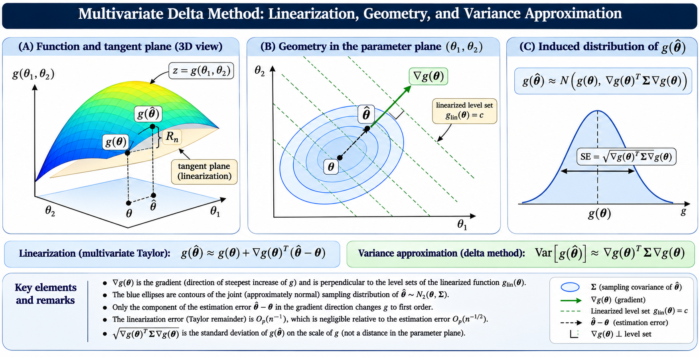

# The underlying idea: linearization

Many relationships in science are nonlinear. Near a particular point, however, a smooth nonlinear function can be approximated by its tangent line (or, with several inputs, by its tangent plane).

For a differentiable function $g$, the **first-order Taylor approximation** around $x_0$ is

$$
g(x) \approx g(x_0)+g'(x_0)(x-x_0).
$$

The right-hand side is an **affine** function of $x$: it has the form $ax+b$. In strict mathematical terminology, a linear function has the form $ax$ and passes through the origin; an affine function can also include an intercept. This distinction does not affect the variance calculation because adding a constant leaves variance unchanged.

This strategy is used throughout science: small-oscillation approximations in physics, linearized dynamical systems in engineering, Newton's method in numerical mathematics, and the propagation of measurement uncertainty.

# The delta method

The **delta method** applies linearization to an estimator in order to approximate the distribution and variance of a **nonlinear transformation** of that estimator.

Let $\hat\theta$ estimate $\theta$. Suppose

$$
\sqrt n(\hat\theta-\theta)\xrightarrow{d}N(0,V).
$$

We want to understand $g(\hat\theta)$ for a differentiable function $g$. Taylor-expanding around the **true parameter** $\theta$ gives

$$
g(\hat\theta)=g(\theta)+g'(\theta)(\hat\theta-\theta)+R_n,
$$

where the remainder $R_n$ is negligible on the $n^{-1/2}$ scale under the usual regularity conditions. Consequently,

$$
\underbrace{g(\hat\theta)-g(\theta)}_{\text{transformed estimation error}}
\approx
\underbrace{g'(\theta)}_{\text{local slope}}
\underbrace{(\hat\theta-\theta)}_{\text{original estimation error}}.
$$

The reason this is useful is the elementary identity

$$
\operatorname{Var}(aX+b)=a^2\operatorname{Var}(X).
$$

Because $g'(\theta)$ is a constant, linearization suggests

$$
\boxed{\operatorname{Var}\{g(\hat\theta)\}\approx[g'(\theta)]^2\operatorname{Var}(\hat\theta).}
$$

It also provides a limiting distribution (when $g'(\theta)\ne0$):

$$
\boxed{\sqrt n\{g(\hat\theta)-g(\theta)\}\xrightarrow{d}N\bigl(0,[g'(\theta)]^2V\bigr).}
$$

Thus, the method accomplishes **two connected tasks**: approximate *variance propagation* and establish *asymptotic normality* after a smooth transformation.

::: {.callout-important}
## Exact normality versus asymptotic normality

If $X$ is exactly normal, an affine transformation $aX+b$ is exactly normal, but a nonlinear transformation generally is not. For example, $e^X$ is lognormal. The delta method does **not** claim nonlinear transformations preserve exact normality: it says that a smooth transformation of an increasingly concentrated, asymptotically normal estimator is **asymptotically normal** after appropriate centering and scaling, provided the first derivative is nonzero.
:::

# Example: the log odds of a binomial proportion

Let $Y\sim\operatorname{Bin}(n,p)$ with $0<p<1$ and $\hat p=Y/n$. The binomial central limit theorem gives

$$
\hat p\;\dot\sim\;N\left(p,\frac{p(1-p)}{n}\right).
$$

Consider $g(p)=\operatorname{logit}(p)=\log[p/(1-p)]$. Its derivative is

$$
g'(p)=\frac1p+\frac1{1-p}=\frac1{p(1-p)}.
$$

Applying the delta-method variance formula yields

$$
\begin{aligned}
\operatorname{Var}\{\operatorname{logit}(\hat p)\}
&\approx \left[\frac1{p(1-p)}\right]^2\frac{p(1-p)}n\\
&=\boxed{\frac1{np(1-p)}}.
\end{aligned}
$$

This also implies the asymptotic normal approximation

$$
\operatorname{logit}(\hat p)\;\dot\sim\;N\left(\operatorname{logit}(p),\frac1{np(1-p)}\right).
$$

The approximation is most useful away from the boundary probabilities $0$ and $1$ and when the expected counts of events and non-events are sufficiently large.

# Multivariate delta method

@fig-multivariate-delta illustrates the geometric idea for two parameters: the nonlinear surface $z=g(\theta_1,\theta_2)$ is replaced locally by its tangent plane at the true parameter vector. The gradient gives the direction and sensitivity of this local change. The covariance matrix determines the uncertainty ellipse of the estimators; projecting that uncertainty through the gradient gives the approximate variance of the transformed estimator.

{#fig-multivariate-delta width=100% fig-alt="Two-panel illustration showing a nonlinear surface with a tangent plane and, in parameter space, a covariance ellipse with a gradient direction."}

With several estimated parameters, write $\hat{\boldsymbol\theta}=(\hat\theta_1,\ldots,\hat\theta_k)^\top$. For a differentiable scalar-valued function $g$, the first-order Taylor expansion is

$$
g(\hat{\boldsymbol\theta})\approx g(\boldsymbol\theta)+\nabla g(\boldsymbol\theta)^\top(\hat{\boldsymbol\theta}-\boldsymbol\theta).
$$

If $\Sigma=\operatorname{Cov}(\hat{\boldsymbol\theta})$, use the linear-combination identity $\operatorname{Var}(\mathbf a^\top\mathbf X)=\mathbf a^\top\operatorname{Cov}(\mathbf X)\mathbf a$ to obtain

$$
\boxed{\operatorname{Var}\{g(\hat{\boldsymbol\theta})\}\approx\nabla g(\boldsymbol\theta)^\top\Sigma\nabla g(\boldsymbol\theta).}
$$

For two inputs this is

$$
\operatorname{Var}\{g(\hat\theta_1,\hat\theta_2)\}\approx
\left(\frac{\partial g}{\partial\theta_1}\right)^2\!\operatorname{Var}(\hat\theta_1)
+\left(\frac{\partial g}{\partial\theta_2}\right)^2\!\operatorname{Var}(\hat\theta_2)
+2\frac{\partial g}{\partial\theta_1}\frac{\partial g}{\partial\theta_2}\operatorname{Cov}(\hat\theta_1,\hat\theta_2).
$$

All derivatives are evaluated at the true parameter values. In applications these are replaced by consistent estimates.

## Connection to propagation of measurement uncertainty

The same formula is often called **first-order (Gaussian) error propagation** in physics and metrology. If $Z=g(X_1,X_2)$ is derived from measured quantities, local slopes determine how uncertainty in each measurement contributes to uncertainty in $Z$. The statistical delta method emphasizes sampling distributions of estimators and asymptotic justification, but the linearization is the same.

# From normal approximation to Wald inference

If an estimator is asymptotically normal and we consistently estimate its variance, we may test $H_0:\theta=\theta_0$ using

$$
Z_W=\frac{\hat\theta-\theta_0}{\widehat{\operatorname{SE}}(\hat\theta)}\xrightarrow{d}N(0,1)
\qquad\text{under }H_0.
$$

For a smooth transformed parameter $\phi=g(\theta)$, the delta method supplies the approximate standard error for $\hat\phi=g(\hat\theta)$, yielding a Wald test or confidence interval **on the transformed scale**.

In the case of the log odds ratio, the appendix proves the familiar standard-error formula. It leads to

$$
Z_W=\frac{\log(\widehat{OR})-\log(OR_0)}{\sqrt{1/a+1/b+1/c+1/d}}.
$$

For $OR_0=1$, the numerator is simply $\log(\widehat{OR})$.

## Connection to likelihood theory

There are two complementary derivations of the asymptotic normality of the *same* log-odds-ratio estimator:

| $2\times2$ table / delta method | Logistic regression / likelihood theory |
|---|---|
| CLT for sample proportions $\hat p_1,\hat p_0$ | CLT for the likelihood score |
| First-order Taylor expansion of the logit transformation | Quadratic expansion of the log-likelihood (equivalently, first-order expansion of its score) |
| Asymptotic normality of $\log(\widehat{OR})$ | Asymptotic normality of the MLE $\hat\beta_1$ |
| Variance from the delta method | Variance from inverse Fisher information |

In unadjusted logistic regression with a binary predictor,

$$
\operatorname{logit}\{P(Y=1\mid X=x)\}=\beta_0+\beta_1x,
\qquad \beta_1=\log(OR),
$$

so $\hat\beta_1=\log(\widehat{OR})$. In this model the usual information-based variance estimate is **exactly the same formula** as the plug-in delta-method estimate derived in the appendix. The normal approximation itself remains asymptotic. The local quadratic approximation of the log-likelihood helps explain this information-based variance; the CLT for the score is also required to justify the Wald reference distribution.

# Limits of first-order linearization

A first-order delta method can fail to give a *nondegenerate* limiting normal distribution when $g'(\theta)=0$. For example, if $g(\theta)=\theta^2$ and the true value is $\theta=0$, then $g'(0)=0$. If $\sqrt n\hat\theta\xrightarrow{d}N(0,V)$, the appropriate nondegenerate result is

$$
n\hat\theta^2\xrightarrow{d}V\chi_1^2,
$$

not a normal limit. Higher-order expansions are then required. Nonsmooth transformations and parameter values on boundaries can also require other methods.

# Appendix: Proof of the asymptotic variance of $\log(\widehat{OR})$ {#sec-appendix}

## A. Set up two independent binomial samples

Consider the $2\times2$ table:

| Group | $Y=1$ | $Y=0$ | Total |
|:--|--:|--:|--:|
| $X=1$ | $a$ | $b$ | $n_1=a+b$ |
| $X=0$ | $c$ | $d$ | $n_0=c+d$ |

Assume independent groups with fixed sample sizes,

$$
A\sim\operatorname{Bin}(n_1,p_1),\qquad C\sim\operatorname{Bin}(n_0,p_0),
$$

where $a$ and $c$ denote their observed event counts. Then

$$
\hat p_1=\frac{a}{n_1},\qquad\hat p_0=\frac{c}{n_0},
$$

and $\operatorname{Cov}(\hat p_1,\hat p_0)=0$ by independence. The parameter and estimator are

$$
\theta=\log(OR)=\operatorname{logit}(p_1)-\operatorname{logit}(p_0),
$$

$$
\hat\theta=\operatorname{logit}(\hat p_1)-\operatorname{logit}(\hat p_0)=\log\!\left(\frac{ad}{bc}\right).
$$

We assume $0<p_0,p_1<1$ and both group sizes grow, with their ratio bounded away from zero and infinity.

## B. Joint approximate distribution of the sample proportions

The two binomial CLTs imply

$$
\begin{pmatrix}\hat p_1\\\hat p_0\end{pmatrix}
\;\dot\sim\;
N_2\!\left[
\begin{pmatrix}p_1\\p_0\end{pmatrix},
\underbrace{\begin{pmatrix}
\dfrac{p_1(1-p_1)}{n_1}&0\\
0&\dfrac{p_0(1-p_0)}{n_0}
\end{pmatrix}}_{\Sigma}
\right].
$$

## C. Compute the gradient of the log odds ratio

Define

$$
g(p_1,p_0)=\log p_1-\log(1-p_1)-\log p_0+\log(1-p_0).
$$

Its gradient is

$$
\nabla g(p_1,p_0)=
\begin{pmatrix}
\dfrac{\partial g}{\partial p_1}\\[6pt]
\dfrac{\partial g}{\partial p_0}
\end{pmatrix}
=
\begin{pmatrix}
\dfrac1{p_1(1-p_1)}\\[6pt]
-\dfrac1{p_0(1-p_0)}
\end{pmatrix}.
$$

Therefore the first-order Taylor expansion is

$$
\hat\theta-\theta\approx
\frac{\hat p_1-p_1}{p_1(1-p_1)}
-\frac{\hat p_0-p_0}{p_0(1-p_0)}.
$$

## D. Propagate the variance

Apply the multivariate variance rule:

$$
\operatorname{Var}(\hat\theta)
\approx\nabla g^\top\Sigma\nabla g.
$$

Because the covariance between the proportions is zero,

$$
\begin{aligned}
\operatorname{Var}(\hat\theta)
&\approx
\left[\frac1{p_1(1-p_1)}\right]^2\frac{p_1(1-p_1)}{n_1}
+\left[-\frac1{p_0(1-p_0)}\right]^2\frac{p_0(1-p_0)}{n_0}\\[8pt]
&=\boxed{\frac1{n_1p_1(1-p_1)}+\frac1{n_0p_0(1-p_0)}}.
\end{aligned}
$$

The negative sign in the second gradient component disappears after squaring. If the groups were dependent, the covariance term would also need to be included.

## E. Replace unknown probabilities by sample proportions

The plug-in variance estimator is

$$
\widehat{\operatorname{Var}}(\hat\theta)
=\frac1{n_1\hat p_1(1-\hat p_1)}+\frac1{n_0\hat p_0(1-\hat p_0)}.
$$

For the first group,

$$
\begin{aligned}
\frac1{n_1\hat p_1(1-\hat p_1)}
&=\frac1{(a+b)\frac{a}{a+b}\frac{b}{a+b}}\\
&=\frac{a+b}{ab}\\
&=\frac1a+\frac1b.
\end{aligned}
$$

Likewise,

$$
\frac1{n_0\hat p_0(1-\hat p_0)}=\frac1c+\frac1d.
$$

Thus,

$$
\boxed{\widehat{\operatorname{Var}}\{\log(\widehat{OR})\}
=\frac1a+\frac1b+\frac1c+\frac1d}
$$

and

$$
\boxed{\widehat{\operatorname{SE}}\{\log(\widehat{OR})\}
=\sqrt{\frac1a+\frac1b+\frac1c+\frac1d}.}
$$

This is an **estimated asymptotic variance**, not the exact finite-sample variance of the log odds ratio. It requires nonzero cell counts to be directly evaluated.

## F. Connection to the Wald statistic

For the null hypothesis $H_0:OR=1$ (equivalently $\theta=0$), the usual test is

$$
\boxed{Z_W=\frac{\log(ad/bc)}{\sqrt{1/a+1/b+1/c+1/d}}\overset{H_0}{\approx}N(0,1).}
$$

This is exactly the conventional coefficient-level Wald statistic obtained from an unadjusted logistic regression of binary $Y$ on binary $X$, with an intercept, when all four cell counts are positive.

## G. Optional numerical check in R

The following chunk can be run when rendering with an R-enabled Quarto installation:

```{r}
#| eval: false
#| echo: true

a <- 40; b <- 60; c <- 20; d <- 80
log_or <- log(a * d / (b * c))
se_delta <- sqrt(1/a + 1/b + 1/c + 1/d)
z_delta <- log_or / se_delta

# Fit a weighted Bernoulli logistic regression to the four cells.
dat <- data.frame(
  X = c(1, 1, 0, 0),
  Y = c(1, 0, 1, 0),
  count = c(a, b, c, d)
)
fit <- glm(Y ~ X, data = dat, weights = count, family = binomial())

c(log_OR = log_or, SE_delta = se_delta, z_delta = z_delta)
coef(summary(fit))["X", ]

stopifnot(isTRUE(all.equal(unname(coef(fit)["X"]), log_or)))
stopifnot(isTRUE(all.equal(unname(sqrt(vcov(fit)["X", "X"])), se_delta)))
```

